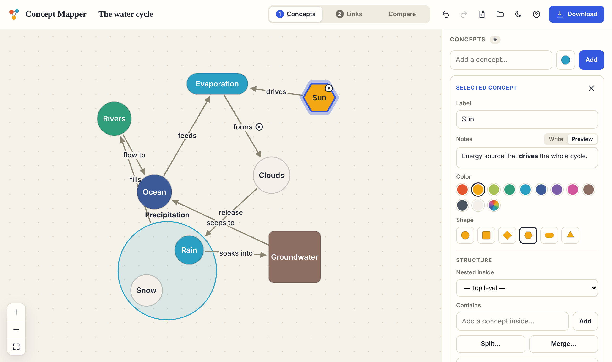

# Concept Mapper

A browser app for writing, editing, and comparing concept maps. It is a single HTML file with no dependencies and no build step.

**Use it here: <https://context-lab.com/concept-mapper/>**



## What it does

- **Build a map in two steps.** Add concepts, then switch to Links and click two concepts to connect them. You can move between the two steps freely.
- **Style and annotate.** Each concept has a label, a color, a shape, and notes. Each link has a label, notes, and an optional arrow. Notes are written in Markdown.
- **Nest concepts to any depth.** A concept that contains others is drawn as a region around them and can be collapsed into a single node.
- **Split and merge concepts.** Split one concept into several and choose where each link goes, or fold several concepts into one.
- **Force-directed layout.** Drag any concept or group; the map settles back into balance when you let go.
- **Save and reopen.** Maps download as JSON files and can be opened again for editing.
- **Edit directly on the map.** Rename in place, drag a handle to link, select several concepts at once, and right-click for a menu of actions.
- **Enter maps quickly.** Type an outline, or keep your hands on the keyboard with Tab and Enter.
- **Compare maps.** Load two or more maps to see what they share, where they differ, and the map common to all of them.
- **Measure agreement.** Nine pairwise similarity measures, a permutation test, per-map statistics, charts, and CSV export.

It works with a mouse or touch, on desktop and phone-sized screens, in light or dark mode.

## Using it

Open the link above, or download `index.html` and open it in a browser. The **?** button in the app opens a full guide; the short version follows.

### Concepts

- Click the title to name the map.
- Type in **Add a concept…** and press Enter. Keep typing to add several in a row, or double-click the canvas.
- The swatch beside the box sets the color and shape for new concepts.
- Click a concept to edit its label, notes, color, and shape, or to delete it.

### Links

- Switch to **Links**, click one concept, then another.
- Click a link to label it, add notes, reverse it, hide its arrow, or delete it.

### Working directly on the map

| To do this | Do this |
| --- | --- |
| Rename a concept or link | Double-click it, or select it and press Enter |
| Link two concepts | Select one and drag its **+** handle onto the other (or Alt-drag from any concept) |
| Add a linked concept | Drag the **+** handle to empty space, or press Tab with a concept selected |
| Add a nested concept | Press Shift+Tab with a concept selected |
| Add a concept | Start typing, or double-click the canvas |
| Select several | Shift-click, Shift-drag a box, or turn on the dashed-square button (for touch) |
| Act on a selection | Drag to move together; use the bar at the top to Link, Merge, Group, or Delete |
| See every action | Right-click, or press and hold on touch |

### Quick entry

Click **Quick entry** under the Add box and type or paste an outline. One concept per line, indent to nest, and use an arrow to link:

```
Memory
  Long-term memory
    Episodic
  Working memory
Hippocampus -> Episodic : encodes
Sleep -> Consolidation -> Long-term memory
```

Pasting several lines straight into the Add box does the same thing.

### Nesting, splitting, and merging

- Nest a concept by choosing a parent under **Nested inside**, by typing in **Add a concept inside…**, or by dragging it over another concept and pausing until the target highlights. Drag it out of the group and pause to un-nest it.
- Double-click a group to collapse or expand it. Links to hidden concepts are drawn to the collapsed group.
- **Split…** and **Merge…** are in the panel for the selected concept.

### Moving around

- Drag the background to pan; scroll or pinch to zoom.
- The buttons at the bottom left zoom and fit the map to the screen.
- On a phone, tap the panel header to collapse or expand it.

### Saving

- **Download** saves the map as a `.json` file. **Open** loads one back in; you can also drop a file on the page.
- Work in progress is kept in the browser's local storage, and changes can be undone with Ctrl/⌘ Z.

## Comparing maps

Switch to **Compare** and load two or more saved maps.

- **Matching.** Concepts are matched by label, ignoring capitalization and extra spaces. A link counts as shared when the same two concepts are connected, whatever its label or direction.
- **Reading the picture.** Dark concepts are in every map, white ones in some, tinted ones in just one. The ring around each concept shows which maps contain it.
- **Views.** *Merged* shows everything, *Common* shows only what every map shares, *Majority* (three or more maps) shows what more than half contain, and *Differences* shows only what is missing from at least one map.
- **Nesting.** Groups are drawn as regions. Concepts that sit under different parents in different maps are listed under *Nested differently*.
- **Reconciling wording.** *Possible matches* lists concepts with nearly identical labels for one-click merging. *Merge…*, Shift-clicking several concepts, or dragging one onto another treats differently worded concepts as one. *Split by map* keeps a shared label apart. All of these affect only the comparison, not the loaded files.
- **Naming.** A file without a name is given one as it loads, and a file whose name is already in use is given a distinguishing label.
- **Exporting.** *Save view* and *Edit view* turn what is on screen, such as the common map, into a map of its own.

### Analysis

The **Map / Analysis** switch at the top left of the comparison opens a dashboard of measures. All of them are computed after any merges and splits you made.

Pairwise measures, shown as a heatmap with a breakdown for any pair:

| Measure | What it is |
| --- | --- |
| Concept overlap | Jaccard index over concepts |
| Link overlap | Jaccard index over links |
| Proposition agreement | Share of shared links with the same label and direction |
| Nesting agreement | Share of shared concepts nested under the same parent |
| Neighborhood similarity | Mean Jaccard overlap of each shared concept's neighbors |
| Centrality agreement | Spearman correlation of link counts over shared concepts |
| Path-distance agreement | Pearson correlation of shortest-path distances between shared concepts |
| Link-structure correlation | Correlation of the two link patterns over shared concepts |
| Overall similarity | 1 − edit distance ÷ its maximum |

- **Significance.** For any pair, a QAP permutation test (2,000 permutations, fixed seed, one-sided) asks whether the maps link their shared concepts more alike than chance. It needs at least four shared concepts.
- **Per-map statistics.** Concepts, links, density, links per concept, nesting levels, groups, components, unlinked concepts, labeled links, and the most connected concepts.
- **Charts.** A concept × map matrix sized by link count, and how many concepts and links appear in exactly 1, 2, … N maps.
- **Three or more maps.** A multidimensional-scaling layout of the maps, an average-linkage dendrogram, and each map's mean similarity to the others.
- **Export.** Per-map statistics, pairwise measures (with QAP p-values), and the concept × map table download as CSV.

The correlations and the QAP test use only the concepts two maps share, so they are undefined or uninformative when little is shared.

## File format

Maps are plain JSON:

```json
{
  "format": "concept-map",
  "version": 2,
  "name": "The water cycle",
  "modified": "2026-11-14T20:05:00.000Z",
  "nodes": [
    { "id": "n1", "label": "Precipitation", "notes": "Markdown text", "color": "#29A0C4",
      "shape": "circle", "parent": null, "collapsed": false, "x": 0, "y": 0 },
    { "id": "n2", "label": "Rain", "notes": "", "color": "#29A0C4",
      "shape": "circle", "parent": "n1", "collapsed": false, "x": 20, "y": 10 }
  ],
  "edges": [
    { "id": "e1", "source": "n2", "target": "n3", "label": "soaks into", "notes": "", "directed": true }
  ]
}
```

| Field | Meaning |
| --- | --- |
| `parent` | `id` of the concept this one is nested inside, or `null` |
| `collapsed` | whether a concept with nested concepts is drawn collapsed |
| `shape` | `circle`, `square`, `diamond`, `hexagon`, `pill`, or `triangle` |
| `x`, `y` | last layout position; optional |
| `directed` | whether the link is drawn with an arrow from `source` to `target` |

The loader is lenient. It also accepts `concepts` for `nodes`, `links` for `edges`, `from`/`to` for `source`/`target`, plain strings as nodes, and references by label instead of `id`. Version 1 files, which lack `parent`, `collapsed`, and link `notes`, load unchanged.

## Development

Everything is in `index.html`: markup, styles, and script. There is nothing to install or build. Edit the file and reload the page.

The site is served by GitHub Pages from the root of the `main` branch.

The app has been exercised with Playwright in Chromium at desktop size and with touch emulation at phone size. The analysis numbers were checked against an independent implementation using networkx and scipy. It has not been tested on physical iOS or Android devices, or in Firefox or Safari.

## License

MIT. See [LICENSE](LICENSE).
